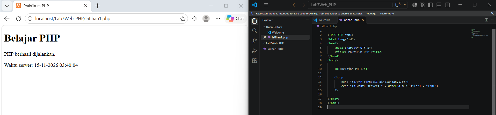
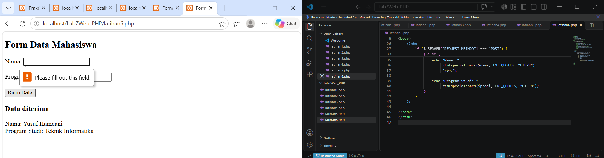
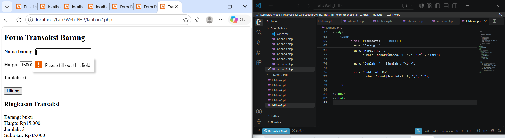
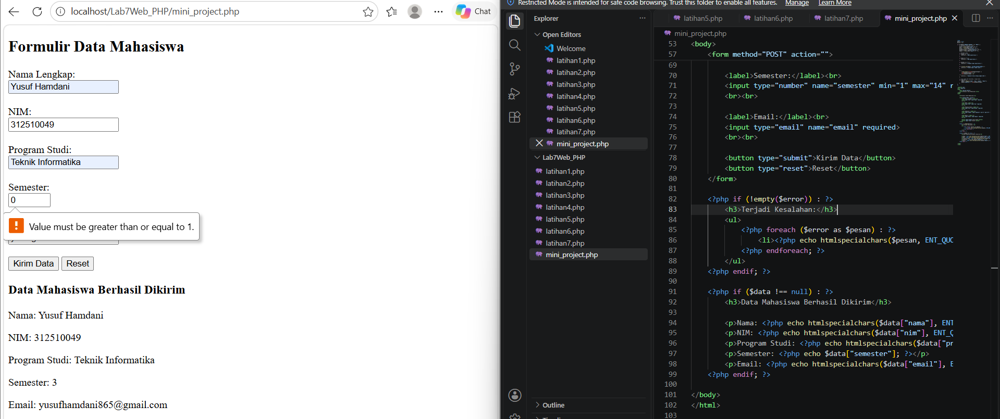
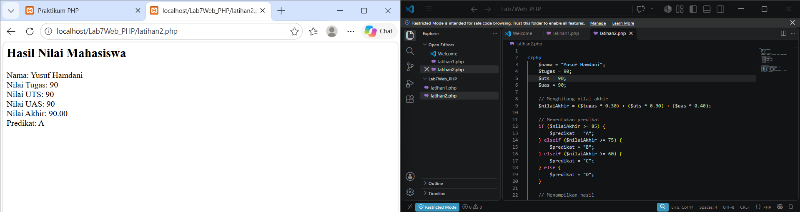
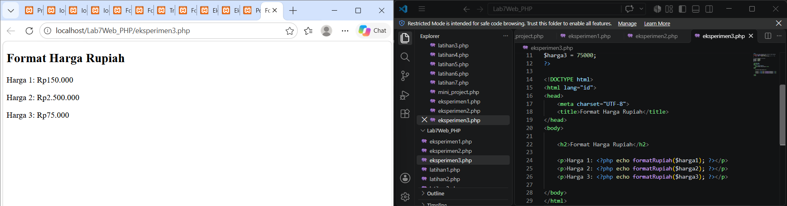
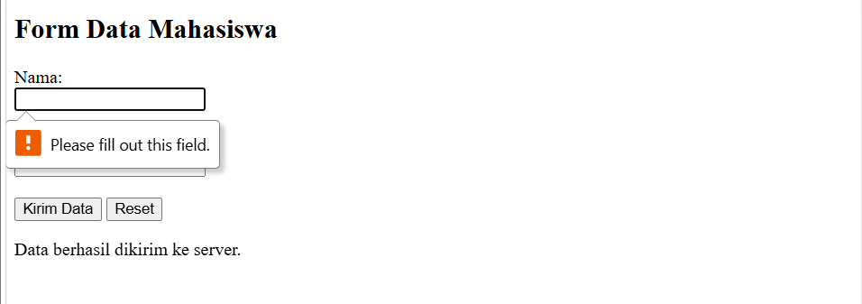

# Praktikum 7 – Pemrograman Web PHP

## Identitas Praktikum

- **Nama:** Yusuf Hamdani
- **NIM:** 312510049
- **Program Studi:** Teknik Informatika
- **Mata Kuliah:** Pemrograman Web
- **Modul:** 7 – Pemrograman Server-Side dengan PHP

## 1. Tujuan Praktikum

Praktikum ini bertujuan untuk memahami dasar pemrograman PHP sebagai bahasa pemrograman server-side. Materi yang dipelajari meliputi penggunaan variabel, operator, percabangan, perulangan, array, function, pemrosesan form menggunakan GET dan POST, serta validasi dan sanitasi input.

## 2. Perangkat yang Digunakan

- Laptop atau komputer
- Visual Studio Code
- XAMPP sebagai server lokal
- Web browser
- Bahasa pemrograman PHP

## 3. Persiapan dan Cara Menjalankan Program

1. Mengaktifkan Apache melalui XAMPP.
2. Membuat folder proyek `Lab7Web_PHP` di dalam folder `htdocs`.
3. Membuka folder proyek menggunakan Visual Studio Code.
4. Membuat dan menyimpan file program dengan ekstensi `.php`.
5. Menjalankan program melalui browser dengan alamat:

   `http://localhost/Lab7Web_PHP/`

## 4. Hasil Praktikum

### 4.1 Latihan 1 – Menjalankan Program PHP

Pada latihan pertama, dibuat program PHP sederhana untuk menampilkan teks menggunakan perintah `echo`. Program dijalankan melalui server lokal XAMPP.



### 4.2 Latihan 2 – Variabel, Operator, dan Percabangan

Pada latihan kedua, dipelajari penggunaan variabel, operator aritmetika, dan percabangan. Program digunakan untuk mengolah nilai dan menentukan hasil berdasarkan kondisi tertentu.


### 4.3 Latihan 3 – Perulangan dan Array

Pada latihan ketiga, dibuat program menggunakan array untuk menyimpan beberapa data. Perulangan `foreach` digunakan untuk menampilkan seluruh data yang tersimpan.


### 4.4 Latihan 4 – Function

Pada latihan keempat, dipelajari cara membuat dan memanggil function dalam PHP. Function digunakan untuk menjalankan tugas tertentu agar kode program lebih terstruktur.


### 4.5 Latihan 5 – Form dengan Metode GET

Pada latihan kelima, dibuat formulir sederhana menggunakan metode GET. Data yang dikirim akan ditampilkan melalui URL browser.


### 4.6 Latihan 6 – Form dengan Metode POST

Pada latihan keenam, dibuat formulir menggunakan metode POST untuk menerima data pengguna. Program memeriksa kelengkapan input dan menggunakan `htmlspecialchars()` untuk membantu menampilkan data dengan lebih aman.



### 4.7 Latihan 7 – Pengolahan Data Sederhana

Pada latihan ketujuh, dibuat program pengolahan data barang yang menerima nama barang, harga, dan jumlah. Program menghitung subtotal berdasarkan harga dikalikan jumlah barang.



### 4.8 Mini Project – Aplikasi Formulir Data Mahasiswa

Mini project ini merupakan penerapan materi PHP dalam bentuk formulir data mahasiswa. Formulir berisi nama, NIM, program studi, semester, dan email. Data dikirim menggunakan metode POST dan diperiksa melalui validasi sebelum ditampilkan.



## 5. Eksperimen Mandiri

### 5.1 Eksperimen 1 – Perhitungan Nilai Rata-Rata

Eksperimen pertama menambahkan perhitungan nilai rata-rata dari tiga komponen nilai. Perhitungan dilakukan menggunakan operator aritmetika.



### 5.2 Eksperimen 2 – Pencarian Nama Menggunakan GET

Eksperimen kedua mengembangkan formulir GET untuk mencari nama dari sebuah array sederhana. Pengujian dilakukan menggunakan kata kunci yang ditemukan dan kata kunci yang tidak ditemukan.

**Pengujian Valid**


**Pengujian Tidak Valid**


### 5.3 Eksperimen 3 – Function Format Rupiah

Eksperimen ketiga membuat function untuk mengubah angka menjadi format mata uang Rupiah agar nilai harga lebih mudah dibaca.



### 5.4 Eksperimen 4 – Validasi NIM

Eksperimen keempat menambahkan validasi NIM agar hanya menerima angka dan memiliki panjang sesuai ketentuan yang ditetapkan.

**Pengujian Valid**


**Pengujian Tidak Valid**


### 5.5 Eksperimen 5 – Tombol Reset pada Form

Eksperimen kelima menambahkan tombol reset pada formulir untuk mengosongkan kembali isian form pada browser. Tombol reset berbeda dengan pengiriman ulang form karena tidak mengirim data untuk diproses kembali oleh server.



## 6. Pengujian Input Valid dan Tidak Valid

Pengujian dilakukan untuk mengetahui apakah program dapat membedakan data yang sesuai dan tidak sesuai dengan ketentuan.

- **Eksperimen 2:** Input valid menggunakan kata kunci yang terdapat dalam array sehingga nama dapat ditemukan. Input tidak valid menggunakan kata kunci yang tidak tersedia.
- **Eksperimen 4:** Input valid menggunakan NIM yang hanya berisi angka dan memiliki panjang sesuai ketentuan. Input tidak valid menggunakan NIM yang tidak memenuhi aturan tersebut.

Dari pengujian tersebut dapat dipahami bahwa validasi diperlukan untuk memastikan data yang diterima sesuai dengan aturan program.

## 7. Struktur Folder

```text
Lab7Web_PHP/
│
├── Screenshot/
│   ├── ss1.png
│   ├── ss2.png
│   ├── ss3.png
│   ├── ss4.png
│   ├── ss5.png
│   ├── ss6.png
│   ├── ss7.png
│   ├── ss8.png
│   ├── ss9.png
│   ├── ss10 valid.png
│   ├── ss10 invalid.png
│   ├── ss11.png
│   ├── ss12 valid.png
│   ├── ss12 invalid.png
│   └── ss13.png
│
├── latihan1.php
├── latihan2.php
├── latihan3.php
├── latihan4.php
├── latihan5.php
├── latihan6.php
├── latihan7.php
├── mini_project.php
├── eksperimen1.php
├── eksperimen2.php
├── eksperimen3.php
├── eksperimen4.php
├── eksperimen5.php
│
└── README.md
```
## 8. Kesimpulan

Melalui praktikum ini, saya memperoleh pemahaman dasar mengenai penggunaan PHP untuk pemrograman server-side. Materi yang dipelajari mencakup variabel, operator, percabangan, perulangan, array, function, serta pemrosesan formulir menggunakan metode GET dan POST.

Praktikum ini juga memberikan pemahaman mengenai pentingnya validasi dan sanitasi input sebelum data ditampilkan atau diproses. Dengan demikian, PHP dapat digunakan untuk membuat aplikasi web sederhana yang mampu menerima, mengolah, dan menampilkan data pengguna.